# Contributing

Contributions - including bug fixes, enhancements, and plugins - are welcome.

Accepted contributions and pull requests will be provided in this project under its MIT license. Contributions that introduce dependencies or code that prevents licensing under the MIT license will be rejected.

This project should be a welcoming, harassment-free space for everyone, regardless of background or identity. You should expect me to behave in a friendly, open, and respectful manner, and I expect people interacting on issues and other areas to do likewise. I may formally adopt a [Code of Conduct](https://www.contributor-covenant.org/version/2/1/code_of_conduct/) at some point if I feel it is needed.

## AI Policy

Below you will find some [discussion](#about-ai) about how I used AI-assisted coding while developing this project. My experience doing that has shaped my viewpoint on the role of AI in software development and resulted in a couple of simple rules related to contributions.

* You, a human, are responsible for the code you produce, whether you produce it using AI assistance or not. Do *not* submit a pull request with Claude or some other agent as a committer.

* I, a human, will review PRs that you submit. Do not waste my time submitting AI-generated pull requests that you cannot discuss and answer questions about. You can even use the MarkupEditor MCP server to collaborate with an AI assistant on writing content for the PR. If I feel like I am interacting with AI on a pull request and not a human, I will just reject it.

If you are using AI to work on this project, be sure to review the [AI Skills](#ai-skills) section below. The skills are designed to help you navigate the multi-tiered dependencies between Swift and JavaScript and to make plugin development simpler.

If I feel like AI contributions are a burden on the project and not a benefit, then I will reconsider this policy.

## Development Requirements

* Xcode or its toolchain, supporting macOS 26 or higher

* Node 24, npm, rollup

It may be possible to support earlier macOS versions, but the earlier you go, the more SwiftUI workarounds or drop-backs to AppKit are required. If earlier versions are important to you, scope out the requirements for support and raise an issue or a discussion on the topic.

### Testing

Run the test suite before submitting a pull request:

```bash
xcodebuild test -scheme MarkupEditorApp -destination 'platform=macOS'
```

The tests use Swift Testing (`@Suite`, `@Test`, `#expect`), not XCTest. Use Swift Testing for any new tests you add.

That `xcodebuild test` command only runs `MarkupEditorAppTests`. A few other areas have their own, separately-run suites and aren't covered by it:

* **markupeditor-app, plugin-kit, and the plugins** (JavaScript, vitest) -- run `npm test --workspaces --if-present` from the repo root. Refer to the [Plugins README](https://github.com/stevengharris/MarkupEditorApp/tree/main/plugins) for more information.

* **MarkupEditorAppLib and MarkupEditorMCP** (the local Swift package) -- run `swift test` from `MarkupEditorAppLib/`.

* **MarkupEditorCLI** -- has no test target yet; changes there are currently only exercised manually.

## Project Structure Overview

```
MarkupEditorApp/
  UI/
    MarkupEditorApp.swift      - App entry point, MarkupEditor global config
    AppDelegate.swift          - NSMenu construction, menu action notifications
    Top Level/
      MarkupDocumentView.swift - Main view, MarkupDelegate conformance, file I/O, plugin dispatch
      SourceView.swift         - Source view panel
      AppToolbarView.swift     - Main window toolbar
      SourceToolbarView.swift  - Source view toolbar
    Info/                      - Log and document info UI
    Insert Dialogs/            - Native macOS dialogs for inserting links, images, and tables
    Settings/                  - App settings UI including general behavior, toolbar, and keymapping, as well as plugins
    Welcome/                   - First-launch welcome flow
  Helpers/
    MarkupDocument.swift       - Document model (URL, metadata, save/open operations)
    AppConfig.swift            - Codable config loaded from appconfig.json
    SyntaxHighlighter.swift    - Source view syntax highlighting
    Metadata/                  - YAML frontmatter parsing/encoding
  Extensions/                  - Base class extensions
MarkupEditorAppLib/            - Local Swift package (own Package.swift) with two targets: MarkupEditorAppLib (plugin/codeview/exporter management, Markdown conversion, and the Control layer backing assistant content-editing tools) and MarkupEditorMCP (the MCP server exposing those tools).
MarkupEditorCLI/               - `markup` CLI tool target; embedded in the app bundle, shipped via signed .pkg
markupeditor-app/              - JavaScript project loaded as a userScript to support Markdown and more
plugin-kit/                    - Shared JavaScript workspace package every plugin builds and tests with (rollup/vitest config, frontmatter, images, export, register helpers)
plugins/                       - JavaScript plugin projects for codeviews and exporters (Mermaid, GeoJSON, HTML front matter, metadata, DocX, EPUB) + plugins.json for discovery
skills/                        - Agent Skills (SKILL.md) covering the three-repo architecture and plugin-authoring conventions, for any AI tool that supports the format
```

The part of this repository related to the Swift app proper probably has a familiar structure for Swift developers. It is built using SwiftUI in Xcode with very few deviations into AppKit because of SwiftUI deficiencies. The UI and model/utility classes and structs are organized in their own directories as you might expect. The MarkupEditorAppLib is a small Swift Package embedded within the project that enables headless testing of the exporters and plugins without having to place a test dependency on the app itself. In Xcode, it shows up as a local package dependency. It is also used by the CLI.

The part that will seem unusual for many Swift developers is the mixture of Swift and JavaScript. This is in large part because the MarkupEditorApp is built on top of the MarkupEditor, a Swift package that wraps calls to an API exposed in the markupeditor-base JavaScript package. The markupeditor-base package in turn depends on ProseMirror to help with the WYSIWYG editing. Here's a diagram to show how it fits together.

> 

The plugins to support exporters and codeviews (e.g., Mermaid and GeoJSON) are also written in JavaScript, and these dependencies have to be brought in to the MarkupEditorApp package. The document you are editing when using the app is, ultimately, a `contentEditable` div inside of a WKWebView, and all of the JavaScript is loaded as ES modules into that view.

Life would be simpler if the Swift Package Manager provided a way to express a dependency on a JavaScript package, but this is not the case. Every JavaScript dependency required in the chain produces a `dist` artifact using `npm build` and `rollup`. To ensure that what you build is up-to-date, the Xcode build process uses a script Build Phase to build the JavaScript dependencies and produce the `dist` artifact ES bundles that are loaded into the WKWebView at runtime. Mixing Swift and JavaScript is, admittedly, kind of complicated and drags you across a broad toolchain that you may not be familiar with.

You don't need to know anything about the JavaScript toolchain just to work in the Swift app proper. However, if you want to work in the WYSIWYG editing area, you will have to venture into the Swift MarkupEditor and perhaps into the JavaScript markupeditor-base. If you want to work on a plugin, you will also be exposed to markupeditor-base and even ProseMirror. Fortunately, if you're using AI, this can be made easier.

## About AI

I created the two original libraries that MarkupEditorApp is built-on (the JavaScript [markupeditor-base](https://github.com/stevengharris/markupeditor-base) and Swift [MarkupEditor](https://github.com/stevengharris/MarkupEditor)) without AI-assisted coding. When Xcode introduced a version with AI integration, I used it to help port the existing iOS/Catalyst version of the Swift MarkupEditor to run on macOS, mainly because I had no real AppKit background and I was curious how the tools performed. With a proper macOS version up and running, I started this project to focus on WYSIWYG editing of Markdown. I used Claude Code and a tool called [conexus](https://github.com/Hellblazer/nexus) to help in the development process. The code and comments are aimed at consumption by humans, not AI. The project's layout and code architecture were designed by me. The project is not "vibe coded", at least in the pejorative sense that I would probably use the term. During development, I used a $20/month Claude Code Pro plan and mostly the Sonnet 5.5 model.

I have a lot of conflicted feelings about using AI tools, and I won't bore you with them here. I will just say that in my experience, the tools can be incredibly useful as a force multiplier for software development. One way they can help is to enable people to work on and contribute to this project without having to understand all of the details under the covers - and there is a *lot* to know about. For example:

* A lot of the heavy lifting associated with WYSIWYG editing is provided using [ProseMirror](https://prosemirror.net). I think ProseMirror is great. Its [documentation](https://prosemirror.net/docs/) is thorough and its [forum](https://discuss.prosemirror.net) is a terrific source of information and support. Still, there are a *lot* of concepts to get your head around when building an editor with ProseMirror.

* ProseMirror capabilities are consumed in [markupeditor-base](https://github.com/stevengharris/markupeditor-base) which in turn exposes its own [API](https://stevengharris.github.io/markupeditor-base/api/index.html) in JavaScript. The markupeditor-base project delivers everything it does using a [web component](https://stevengharris.github.io/markupeditor-base/guide/index.html#markupeditor-as-a-web-component). It comes with a toolbar and can be used directly in JavaScript as a WYSIWYG editing tool. Try it out on the markupeditor-base [web site](https://stevengharris.github.io/markupeditor-base/) and scan the [Developer's Guide](https://stevengharris.github.io/markupeditor-base/guide/index.html) to learn more.

* The Swift [MarkupEditor](https://github.com/stevengharris/MarkupEditor) library delivers WYSIWYG editing capabilities using a SwiftUI-based MarkupEditorView. Under the covers, that SwiftUI view uses a WKWebView subclass that loads the markupeditor-base web component (which includes the ProseMirror runtime machinery). The Swift MarkupEditor library wraps the JavsScript markupeditor-base API with Swift using `executeJavaScript` from within the WKWebView subclass.

* I don't see a lot of projects combining Swift and JavaScript, and the mechanics of doing so in a build have to be hand crafted. The MarkupEditorApp was designed for extensibility using a plugin mechanism. Plugins are built in JavaScript. They can be quite powerful because they have access to the markupeditor-base API as well as a lot of the ProseMirror API. They can even call back into Swift to make things happen, too.

AI tools are adept at navigating this kind of complexity, especially if they are armed with the right skills.

### AI Skills

If you're using [Claude Code](https://claude.com/product/claude-code), install this repo's skills first. They cover the three-repo architecture and plugin-authoring conventions so you are not starting from scratch:

```bash
npx skills add stevengharris/MarkupEditorApp --skill developing-markupeditorapp
```

Building a plugin? Also install the plugin-specific skills:

```bash
npx skills add stevengharris/MarkupEditorApp --skill writing-markupeditor-plugins
npx skills add stevengharris/MarkupEditorApp --skill writing-codeview-plugins
npx skills add stevengharris/MarkupEditorApp --skill writing-exporter-plugins
```

The `writing-markupeditor-plugins` skill covers the contract shared by every plugin type. The `writing-codeview-plugins` skill is specific to codeview plugins, such as the Mermaid diagram support. Similarly, the writing-exporter-plugins skill covers exporters. After writing these skills, I tested them from a cloned repository by creating a simpler version of the geoJSON codeview plugin and and the EPUB exporter, using Claude Code.

Once installed, just describe what you're trying to do -- Claude Code loads the relevant skill automatically. File an [issue](https://github.com/stevengharris/MarkupEditorApp/issues) if you encounter a markupeditor-base, MarkupEditor, or MarkupEditorApp bug.

If you are using something other than Claude Code and find these instructions need modification to handle your case, please file an issue.