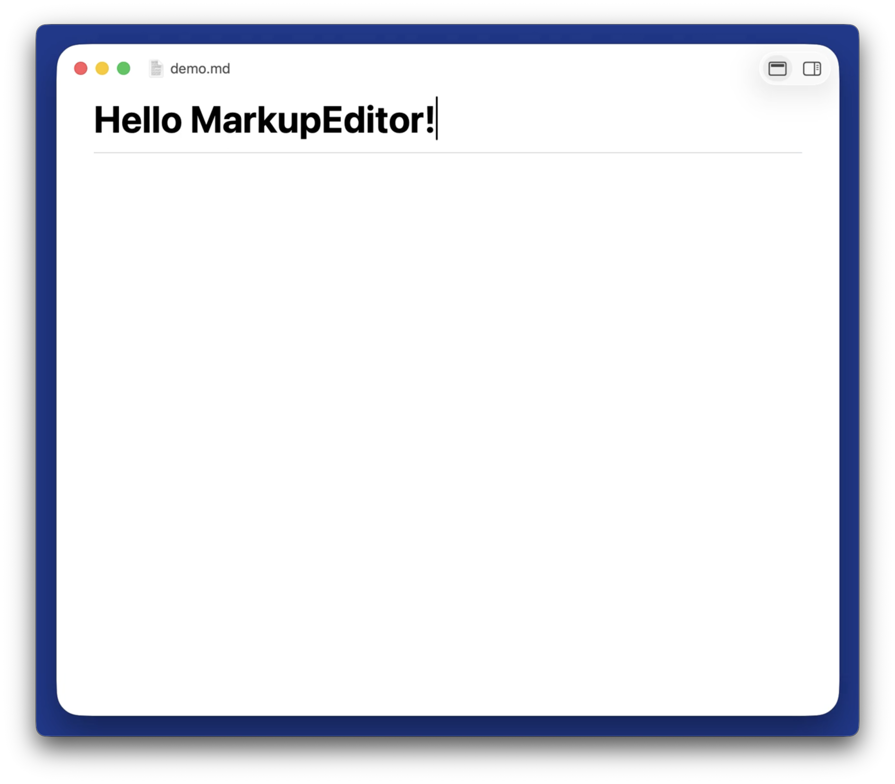
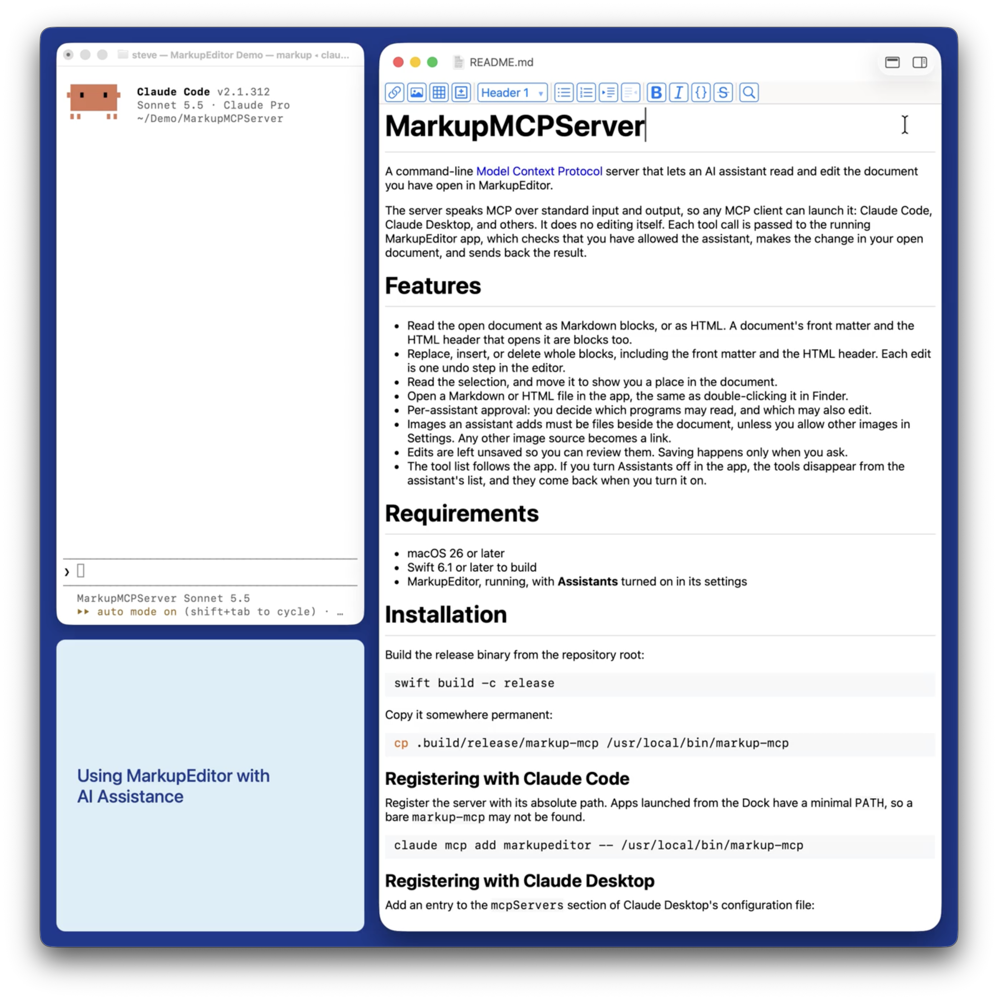

# Welcome to MarkupEditor

This is a sample document you can use to try out the editor when you open it for the first time. Feel free to edit it. Or, just scan through it for more information before opening a file (`File->Open` or ⌘+O) or creating a new one (`File->New` or ⌘+N).

## Demos

`⌥+Click` on a linked demo below to watch the video if you are connected to the Internet.

| Editing Overview | AI Assistance |
| --- | --- |
| A five minute demonstration of what it's like to edit using the MarkupEditor. | A quick look at collaborative editing with an AI assistant using the MCP server. |
|  |  |

Other areas you might want to explore:

* Settings (⌘+,) let you customize the editor's behavior and look, and for subscribers, gives you access to automated updates.
* The right side panel provides access to:
  * **The log**. Shows what you did in this editing session, including any warnings/errors that might occur.
  * **The plugin catalog**. See what plugins you have installed and add new ones.
  * **Templates**. Add your own templates for the types of documents you work with routinely, then use File -> New from template.

## Source and Issues

The MarkupEditor is *completely* [open source](https://github.com/stevengharris/MarkupEditorApp). If you're a developer, you can learn more about it in the README. If you encounter bugs or something you can't live without, please file an [issue](https://github.com/stevengharris/MarkupEditorApp/issues) on GitHub.

## Enjoy!