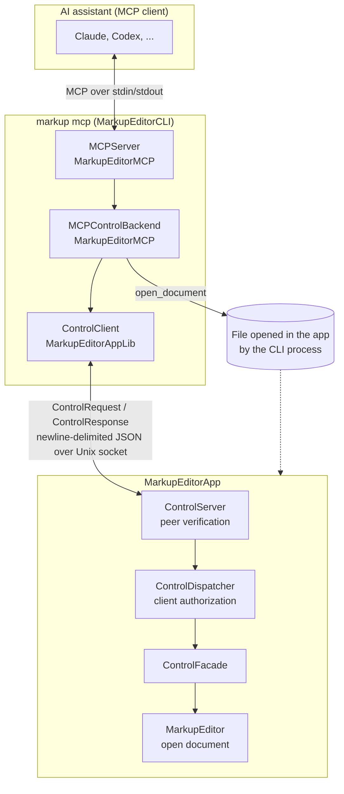

# MarkupEditorAppLib

There are two library products in MarkupEditorAppLib Swift package:

1. **MarkupEditorAppLib** - Contains much of the core functionality for the MarkupEditorApp. The MarkupEditorApp, the MarkupEditorCLI, and various tests import this library.

2. **MarkupEditorMCP** - Contains the code for the Model Context Protocol (MCP) server. Only the CLI imports this library.

The package is divided in this way so that the MarkupEditorApp proper does not contain the MCP server, which is only part of the CLI.

## Packaging The Package

The MarkupEditorAppLib and the MarkupEditorApp need to be kept in lock-step, so the MarkupEditorAppLib is part of the MarkupEditorApp repository. MarkupEditor app has a package dependency on MarkupEditorAppLib. When viewed in Xcode, the MarkupEditorAppLib shows up as a local dependent package. Therefore, when you search in Xcode when working on the MarkupEditorApp project, your searches will not typically include MarkupEditorAppLib.

## Project Structure

```
MarkupEditorAppLib/
├── Package.swift                  Package manifest: two library products, two test targets
├── Sources/
│   ├── MarkupEditorAppLib/        Core library shared by the app, the CLI, and tests
│   │   ├── Control/               Lets an outside process control the open document
│   │   │   ├── Access/            Client identity, peer verification, and approval of clients
│   │   │   ├── Tools/             Control tool definitions, dispatcher, and facade onto the app
│   │   │   ├── Transport/         Control socket: client, server, and wire protocol
│   │   │   └── MCPRegistration.swift  Registering the MCP server with assistants
│   │   ├── Plugins/               Plugin catalog, install, discovery, and exporters
│   │   ├── Updates/               Update feed, gating, and subscription handling
│   │   ├── Helpers/               Build variant, Markdown conversion, JSON, and other utilities
│   │   └── Extensions/            Extensions to MarkupEditor and Foundation types
│   └── MarkupEditorMCP/           MCP server library, imported only by the CLI
│       ├── MCPServer.swift        The MCP server
│       ├── MCPControlBackend.swift  Forwards MCP tool calls to the app over the control socket
│       ├── MCPContent.swift       Content types returned from tools
│       ├── MCPToolResult.swift    Tool results
│       └── DescriptorTransport.swift  Transport for the MCP server
└── Tests/
    ├── MarkupEditorAppLibTests/   Tests for MarkupEditorAppLib, mirroring the Sources layout
    └── MarkupEditorMCPTests/      Tests for MarkupEditorMCP
```

## Building and Running the Tests

The package requires macOS 26.3 or later. Its dependencies (MarkupEditor, the MCP Swift SDK, and swift-log) are fetched automatically the first time you build.

To build both libraries from the command line, run this from the `MarkupEditorAppLib` directory:

```bash
swift build
```

To run all the tests, including those for both MarkupEditorAppLib and MarkupEditorMCP:

```bash
swift test
```

The tests use Swift Testing (`@Suite`, `@Test`, `#expect`), not XCTest. To run just one test target, or a single suite or test, use `--filter`:

```bash
swift test --filter MarkupEditorMCPTests
swift test --filter ControlDispatcherTests
```

You can also run the tests from Xcode. Open the `MarkupEditorAppLib` folder (or the MarkupEditorApp project, where the package appears as a local dependency) and use the Test navigator, or press ⌘U with the `MarkupEditorAppLib` scheme selected.

Note that `xcodebuild test -scheme MarkupEditorApp` runs only `MarkupEditorAppTests`. It does not run the tests in this package, so run `swift test` here separately before submitting a pull request.

## MCP and the MarkupEditor

The MCP server is not part of the MarkupEditorApp. It runs in a separate process started by the CLI (`markup mcp`), and the assistant launches that process and talks to it over stdin/stdout using the [Model Context Protocol](https://modelcontextprotocol.io). The server in turn talks to the running MarkupEditorApp over a Unix domain socket, which is the app's control channel.



The pieces fit together like this:

* **MCPServer** (MarkupEditorMCP) speaks MCP to the assistant. It lists the available tools, and it tells the assistant when the list changes, for example when the app starts or assistants are turned on or off.

* **MCPControlBackend** (MarkupEditorMCP) turns each tool call into a `ControlRequest`, tagged with the identity of the program that launched the server. `ControlClient` sends it over the socket.

* **ControlServer** (MarkupEditorAppLib, running inside the app) accepts connections on the socket. The socket file is readable only by your user account, and each connecting process is verified before any request is read.

* **ControlDispatcher** (MarkupEditorAppLib, running inside the app) decodes the request, checks whether that client is allowed to use the tool, asking you the first time, and runs it against the `ControlFacade`. The app supplies the implementation of the facade, which reads and edits the open document. The result goes back as a `ControlResponse`.

* **open_document** is the exception. It is handled in the CLI process rather than sent over the socket, because only a process outside the app's sandbox can hand the app a file to open.

Because the server needs the app, it can only do useful work while MarkupEditor is running with assistants turned on and the client allowed.