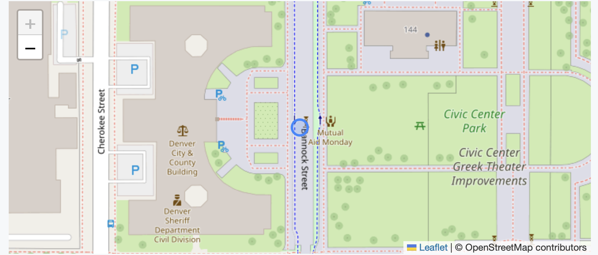

# GeoJSON

Show places, routes, and areas as a live, interactive map right in your MarkupEditor document.

A map in your document is just a code block that contains a few lines of text describing where something is. Switch the block to **Map** and it becomes a map you can pan and zoom. Switch back to **Source** to edit the text. The document stays plain Markdown, so the map travels with your file.

## What is GeoJSON?

[GeoJSON](https://geojson.org) is a simple, widely used text format for describing geographic features: a point (a city), a line (a route), or a polygon (a park, a state boundary). It is an open standard, [RFC 7946](https://datatracker.ietf.org/doc/html/rfc7946), and many mapping tools can read and write it. This block describes Denver, Colorado, with its longitude first and latitude second:

````markdown
```geojson
{
  "type": "Feature",
  "properties": { "name": "Denver, CO" },
  "geometry": {
    "type": "Point",
    "coordinates": [-104.9903, 39.7392]
  }
}
```
````

which would display as an interactive map in the MarkupEditor with this plugin installed as (below is just a screenshot):



You do not have to write GeoJSON by hand. A tool such as [geojson.io](https://geojson.io) lets you draw on a map and copy the result. Paste it into a code block whose language is `geojson`.

GeoJSON works in other places too. [GitHub](https://docs.github.com/en/repositories/working-with-files/using-files/working-with-non-code-files#mapping-geojson-files-on-github) and GitLab show `.geojson` files as interactive maps, and GitHub also draws a `geojson` block in a Markdown file as a map. Wikipedia can draw maps from GeoJSON, and [geojson.io](https://geojson.io) and [uMap](https://umap.openstreetmap.fr) import and edit it. Where a site does not support it, a `geojson` block just appears as an ordinary code block.

## Using the plugin

1. Install **GeoJSON** from the Plugins tab in the app's right side panel. 
2. Add a code block and set its language to `geojson`, or start from Markdown with a fenced block marked `geojson`.
3. Select the block and choose the **Map** tab to see the map. Choose **Source** to edit the text.

If the text is not valid GeoJSON, the block stays on **Source** and the problem is reported in the app's side panel. The [example document](https://github.com/stevengharris/MarkupEditorApp/blob/main/plugins/codeview-geojson/example.md) has maps you can open and try in the MarkupEditor. If you have this plugin installed, the GeoJSON code blocks will display maps; otherwise, they will just display like any other code block.

## How it works

The plugin draws your GeoJSON on a [Leaflet](https://leafletjs.com) map over tiles from [OpenStreetMap](https://www.openstreetmap.org), the community-maintained map of the world. The map zooms to fit what you described, shows points as markers, and shows lines and polygons as outlines. You can drag to pan and scroll or pinch to zoom, and the OpenStreetMap attribution stays visible in a corner, as OpenStreetMap's [tile usage policy](https://operations.osmfoundation.org/policies/tiles/) requires.

## Privacy and offline use

To show the map, the MarkupEditor requests tiles for the visible area from OpenStreetMap's servers, so OpenStreetMap can see which part of the world you are viewing. The text of your document is not sent. Without a network connection, the map still shows your shape and the pan and zoom controls on a plain gray background, because the tiles are simply missing.

## For Plugin Developers

To build or contribute a plugin of your own, see the [plugin developer documentation](https://github.com/stevengharris/MarkupEditorApp/blob/main/plugins/README.md). The source for this plugin is in this directory.

MIT licensed.
