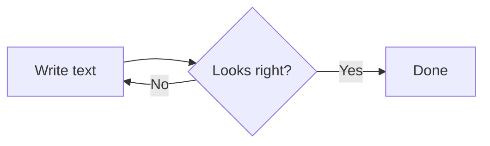
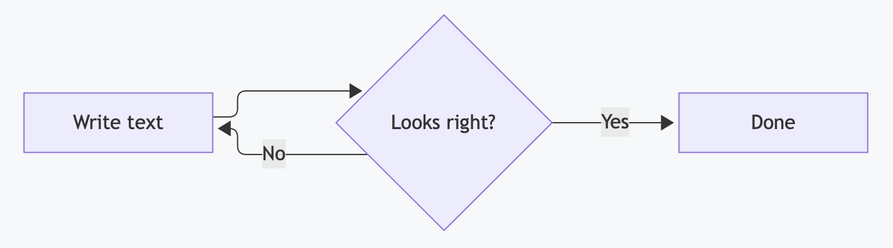

<p align="center"></p>

# Mermaid

Draw flowcharts, sequence diagrams, timelines, and more right in your MarkupEditor document, from a few lines of text.

A diagram in your document is just a code block that describes it. Switch the block to **Diagram** and it becomes a drawing. Switch back to **Source** to edit the text, and the drawing updates. The document stays plain Markdown, so the diagram travels with your file.

## What is Mermaid?

[Mermaid](https://mermaid.js.org) is a simple text language for describing diagrams. You write what connects to what, and Mermaid decides how to lay it out. It covers flowcharts, sequence diagrams, class diagrams, state diagrams, Gantt charts, pie charts, entity-relationship diagrams, and [many other kinds](https://mermaid.js.org/intro/syntax-reference.html). This block describes a small flowchart:

````markdown

````

which would display as a diagram in the MarkupEditor with this plugin installed:



You do not have to learn the syntax in advance. The Mermaid [live editor](https://mermaid.live) shows the diagram as you type, and you can paste the result into a code block whose language is `mermaid`.

Mermaid works in other places too. [GitHub](https://docs.github.com/en/get-started/writing-on-github/working-with-advanced-formatting/creating-diagrams) and GitLab draw a `mermaid` block in Markdown as a diagram, and so do Obsidian and Notion. Where a site does not support it, a `mermaid` block just appears as an ordinary code block.

## Using the plugin

1. Install **Mermaid** from the Plugins tab in the app's right side panel.
2. Add a code block and set its language to `mermaid`, or start from Markdown with a fenced block marked `mermaid`.
3. Select the block and choose the **Diagram** tab to see the drawing. Choose **Source** to edit the text.

If the text is not valid Mermaid, the block stays on **Source** and the problem is reported in the app's side panel. The [example document](https://github.com/stevengharris/MarkupEditorApp/blob/main/plugins/codeview-mermaid/example.md) has several kinds of diagrams you can open and try in the MarkupEditor. If you have this plugin installed, the Mermaid code blocks will display diagrams; otherwise, they will just display like any other code block.

## How it works

The plugin hands the text of the block to the [Mermaid library](https://www.npmjs.com/package/mermaid), which draws it as an SVG image inside your document. The diagram follows your Mac's light or dark appearance and redraws when you change it, and you can copy, cut, and paste the whole block as you would any other.

If you also have the DocX or EPUB exporter installed, diagrams are included in the exported file as images. A diagram that cannot be drawn is exported as plain text instead.

## Privacy

Mermaid is bundled with the plugin and draws everything on your Mac. Drawing a diagram does not use the network, and the text of your document is not sent anywhere.

## For Plugin Developers

To build or contribute a plugin of your own, see the [plugin developer documentation](https://github.com/stevengharris/MarkupEditorApp/blob/main/plugins/README.md). The source for this plugin is in this directory.

MIT licensed.
