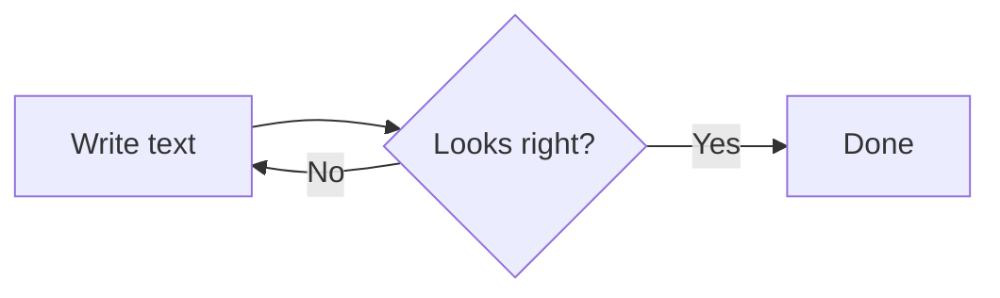
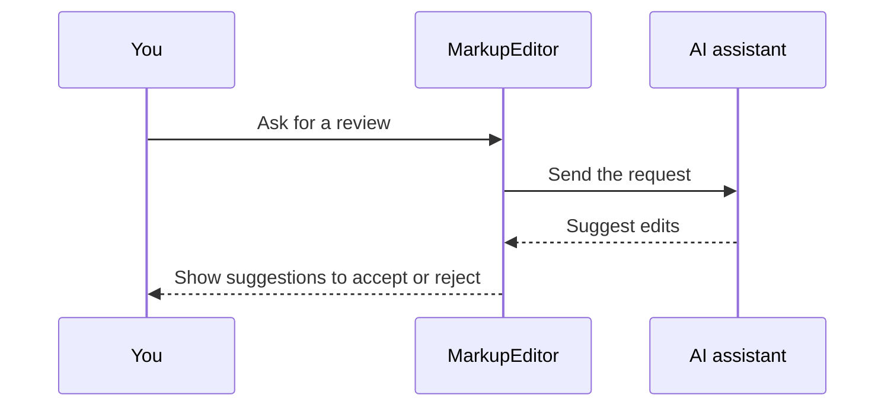
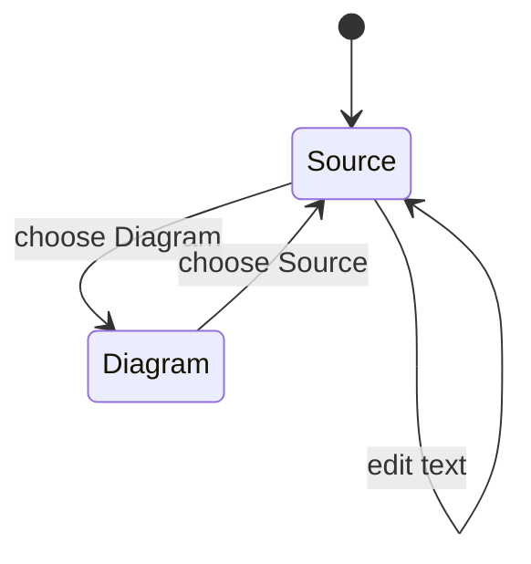
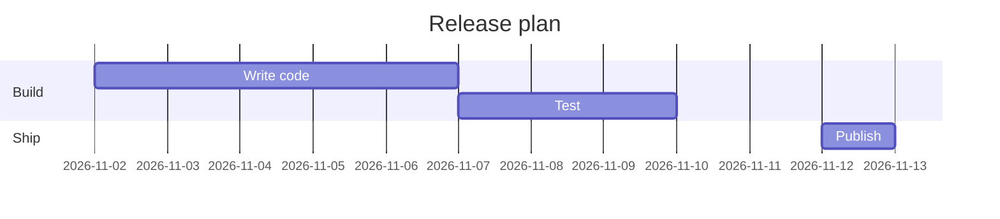
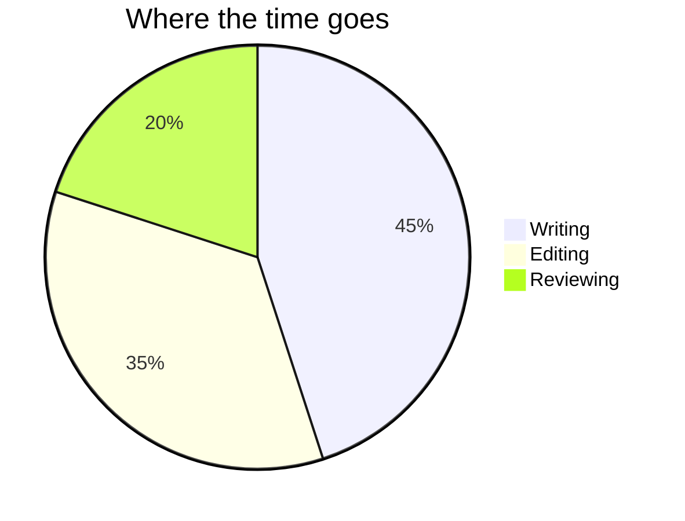

# Mermaid Plugin Example

Open this file in MarkupEditor with the Mermaid plugin installed. Each valid code block below should render as a diagram, not raw text (the last block, further down, is deliberately invalid and stays as text). Select a block and use the **Source** / **Diagram** tabs to switch between the two views. They appear just above the block, or just below it if the block sits too close to the top of the view. Edit the text in **Source** and the diagram redraws when you switch back.

## Flowchart

A flowchart reads left to right here (`LR`). Square brackets make a box and braces make a decision.



## Sequence diagram

Who talks to whom, in order.



## State diagram

States and the transitions between them.



## Gantt chart

A simple schedule.



## Pie chart

Slices are labeled with their share of the total.



## Invalid content falls back to Source

The block below is not valid Mermaid (`flowchart` is misspelled and the arrow has no target). It should stay on **Source**, showing the raw text, and clicking its Diagram tab bounces straight back to Source with no visible change. Opening this file causes the block to report an error the moment it is rendered, which you should see appear in the app's side panel. That is expected, not a bug.

```mermaid
flowchat LR
    Start -->
```